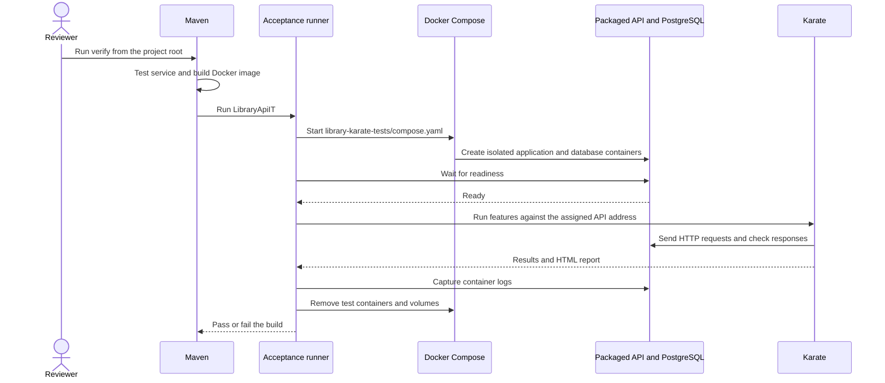
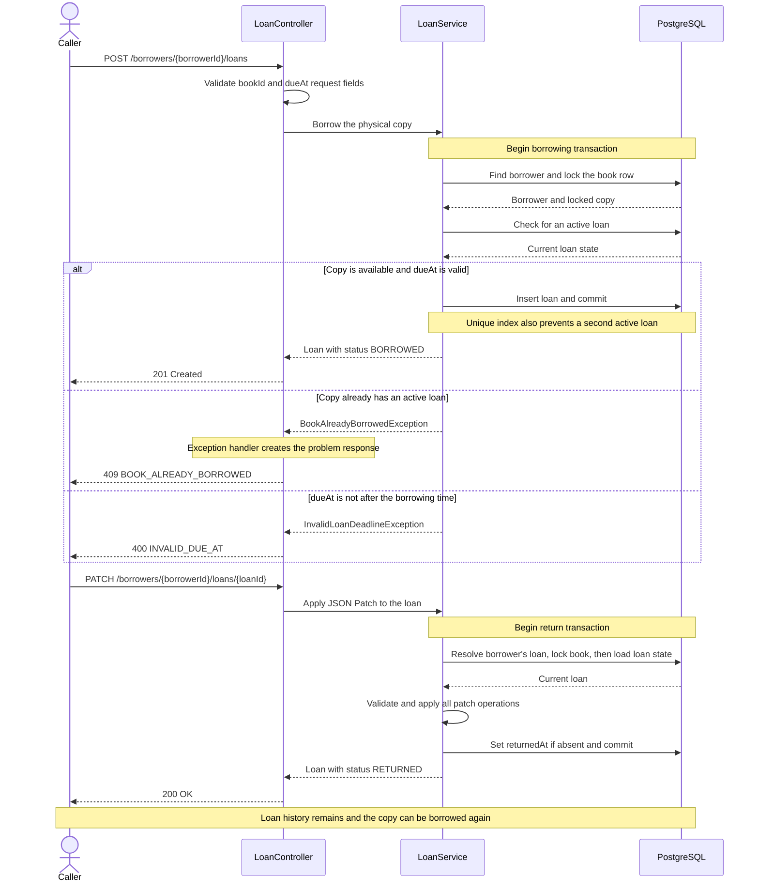

# Library System

A REST API built for a coding assessment: register borrowers, register physical book copies, see what is available, borrow a copy, and return it. The focus is on clear API behavior, reliable database updates, and tests that exercise the packaged application.

The application uses Java 17, Spring Boot, and PostgreSQL. Returned loans stay in the database so borrowing history is preserved.

## Why three Maven modules?

The modules follow the path from application code to a tested Docker image:

```text
library-service  -->  library-image  -->  library-karate-tests
Build the API        Package it         Test it over HTTP
```

| Module | Responsibility | Why keep it separate? |
| --- | --- | --- |
| [library-service](library-service) | Contains the API, business rules, database migrations, unit tests, and PostgreSQL integration tests. Produces the executable Spring Boot JAR. | The backend can be developed and unit-tested on its own. |
| [library-image](library-image) | Takes the service JAR through Maven artifact resolution and builds the Docker image. | Packaging has an explicit place in the build, without recompiling the application inside Docker. |
| [library-karate-tests](library-karate-tests) | Owns the acceptance-test Compose stack, starts the built image with a fresh PostgreSQL database, and runs HTTP tests. | The tests check the application's public behavior without depending on service implementation classes. |

There is one running application. Maven builds these three modules in order, coordinated by the root `pom.xml`. The Karate runner reads the image ID written by the image build, so it tests the exact image just produced, even if an older image has the same tag.

For this assessment, the split makes the build, packaging, and acceptance checks easy to follow. It also lets a reviewer work on the service alone or verify the whole delivery path with one Maven command.

## Getting started

You can start the full application in Docker, run the service locally for development, or let Maven run the acceptance tests. Choose the workflow below that matches what you want to do.

### Prerequisites

- JDK 17, with `JAVA_HOME` pointing to it.
- Maven 3.9.11, with `mvn` on your PATH.
- Docker running with Linux container support and Docker Compose v2; `docker` must be on your PATH.
- Port **8080** available if you want to run the service locally. Database and acceptance-test host ports are assigned automatically.
- Internet access for the first build to download uncached dependencies and images.

Start each workflow from the project root. If you have changed into a module directory, run `cd ..` to return to the root first.

### Start the full stack with Docker Compose

> **Full stack: API + PostgreSQL.** Use [library-karate-tests/compose.yaml](library-karate-tests/compose.yaml).

Build the application image from the project root, then navigate into **`library-karate-tests`**, the directory containing the full stack's Compose file.

```sh
mvn -pl library-image -am package
cd library-karate-tests
docker compose up -d --wait
docker compose port application 8080
```

The first command builds the image and runs the service unit tests. Compose then starts both containers. `-d` keeps them running in the background, and `--wait` waits until they are healthy. **These commands start the application; they do not run Karate.**

The final command prints the API's assigned host port, for example `127.0.0.1:32778`. With that example port, open `http://localhost:32778/swagger-ui.html` or call `http://localhost:32778/api/v1/books`. Use the port actually printed in all other API examples too. PostgreSQL is reachable only inside the Compose network.

See [Manage the manual Compose stack](#manage-the-manual-compose-stack) for logs, shutdown, and optional settings. To switch to another workflow, run `cd ..` first.

### Develop locally and try the API

Start Docker, then run the service with its `local` profile.

```sh
mvn -pl library-service spring-boot:run '-Dspring-boot.run.profiles=local'
```

The API runs in your JVM at `http://localhost:8080`. Spring Boot starts PostgreSQL using [library-service/compose.local.yaml](library-service/compose.local.yaml), discovers its connection details, and applies the Flyway migrations. You can edit code, attach a debugger, and send requests without building an application image.

Keep this command running while trying the API. Press **Ctrl+C** to stop the application; Spring Boot also stops the database containers it started. Your local database data is kept for the next session.

### Check the packaged application

To build the image and run the acceptance tests, use this command from the project root:

```sh
mvn -pl library-karate-tests -am verify
```

Maven builds the service and image first. The acceptance runner then starts [library-karate-tests/compose.yaml](library-karate-tests/compose.yaml), waits for the API to be ready, and runs Karate. It saves the logs and removes the test containers and their database volumes afterward, including when a scenario fails.

You do not need to change into the test module or start Compose yourself. The runner locates the file and manages the stack. Its fresh database and automatically assigned ports let it run alongside your local service. See [Testing and Karate](#testing-and-karate) for the feature files and reports.



### Access the local API

| What to open | Address |
| --- | --- |
| Swagger UI: browse endpoints and send requests | <http://localhost:8080/swagger-ui.html> |
| API base URL | `http://localhost:8080/api/v1` |
| OpenAPI specification | <http://localhost:8080/v3/api-docs> |
| Readiness, including database connectivity | <http://localhost:8080/actuator/health/readiness> |

These addresses apply to the service started with the `local` profile. Swagger UI is the easiest place to try the requests below: expand an endpoint, select **Try it out**, enter its path parameters and request body, and select **Execute**. No authentication is required in this assessment.

The automated Karate stack uses its own API address and is removed when the run finishes. To explore the API yourself, keep the local service running or [start the full stack with Docker Compose](#start-the-full-stack-with-docker-compose).

## Try a complete borrowing flow

All paths in this section are relative to `http://localhost:8080/api/v1`. Use `Content-Type: application/json` for POST requests and `application/json-patch+json` for PATCH requests.

| Method | Path | Purpose | Success |
| --- | --- | --- | --- |
| `POST` | `/borrowers` | Register a borrower. | `201 Created` |
| `POST` | `/books` | Register one physical copy. | `201 Created` |
| `GET` | `/books?page=0&size=20` | List a page of copies with their availability. | `200 OK` |
| `POST` | `/borrowers/{borrowerId}/loans` | Borrow a copy with an expected return deadline. | `201 Created` |
| `PATCH` | `/borrowers/{borrowerId}/loans/{loanId}` | Return a specific loan. | `200 OK` |

### 1. Register a borrower

Send `POST /borrowers`:

```json
{
  "name": "Aisha Rahman",
  "email": "aisha@example.com"
}
```

Example response:

```json
{
  "id": 1,
  "name": "Aisha Rahman",
  "email": "aisha@example.com"
}
```

Keep the returned `id` as your `borrowerId`. Emails are trimmed, lowercased, and unique; use another email if you repeat this step.

### 2. Register a physical book copy

Send `POST /books`:

```json
{
  "isbn": "9780134685991",
  "title": "Effective Java",
  "author": "Joshua Bloch"
}
```

The response contains the generated copy `id`, the submitted book details, and `available: true`. Keep this `id` as your `bookId`.

Each successful request creates a physical copy. Sending the same body twice creates two different copy IDs sharing the same ISBN. An existing ISBN must keep the same title and author; conflicting metadata returns `409 Conflict`.

### 3. List the books

Send `GET /books` with no request body. The default is the first page (`page=0`) with a page size of 20. To choose a page, use `GET /books?page=1&size=20` for the second page. Page numbers are zero-based; `size` must be between 1 and 50. Negative pages, invalid integers, and sizes outside that range return `400 Bad Request`.

Example response before borrowing:

```json
{
  "content": [
    {
      "id": 1,
      "isbn": "9780134685991",
      "title": "Effective Java",
      "author": "Joshua Bloch",
      "available": true
    }
  ],
  "page": 0,
  "size": 20,
  "totalElements": 1,
  "totalPages": 1
}
```

The `content` array includes borrowed copies with `available: false`, ordered by copy ID. `size` is the requested page size; `totalElements` and `totalPages` describe the full library. An empty library returns `content: []`, `totalElements: 0`, and `totalPages: 0`. A page beyond the last page returns an empty `content` array while retaining the totals.

### 4. Borrow the copy

Send `POST /borrowers/{borrowerId}/loans`, using the borrower ID from step 1:

```json
{
  "bookId": 1,
  "dueAt": "2027-01-15T10:00:00Z"
}
```

Use the actual book ID from step 2 and choose a `dueAt` that is **in the future when you send the request**. It must be an ISO-8601 timestamp with a timezone.

Example response; IDs and timestamps will vary:

```json
{
  "id": 1,
  "borrowerId": 1,
  "bookId": 1,
  "borrowedAt": "2026-11-17T10:00:00Z",
  "dueAt": "2027-01-15T10:00:00Z",
  "returnedAt": null,
  "status": "BORROWED",
  "overdue": false
}
```

Keep the response `id` as your `loanId`. The copy now appears as unavailable in `GET /books`. A second attempt to borrow that copy returns `409`, including a repeat request from the same borrower.

### 5. Return the loan

Send `PATCH /borrowers/{borrowerId}/loans/{loanId}` with **`Content-Type: application/json-patch+json`**:

```json
[
  { "op": "replace", "path": "/status", "value": "RETURNED" }
]
```

The response is the loan with `status: "RETURNED"`, a server-generated `returnedAt`, and `overdue: false`. The copy becomes available again, and its next borrowing creates a new loan ID. Returning it under a different borrower ID gives `404`.

Repeating this return succeeds and keeps the original return timestamp. Replaying an old loan's return also leaves any later loan for the same copy untouched.

The patch endpoint supports `replace` and `test` on `/status` only; `replace` accepts `RETURNED` only. To require that the loan is still borrowed before returning it, send:

```json
[
  { "op": "test", "path": "/status", "value": "BORROWED" },
  { "op": "replace", "path": "/status", "value": "RETURNED" }
]
```

All operations must succeed before changes are persisted. A failed `test` returns `409` and leaves the loan unchanged. Retrying this conditional patch after a successful return therefore returns `409`. An empty patch is a successful no-op.

## How borrowing and returning work

The sequence below starts after a borrower and a physical copy have been registered. Database calls go through Spring Data JPA repositories.



Borrow and return both lock the physical copy's row before changing loan state. Requests for the same copy are coordinated, while different copies can be borrowed independently. A PostgreSQL partial unique index provides a second guarantee: only one loan per copy can have `returned_at IS NULL`. Lock waits are bounded to five seconds; a timeout returns `409 RESOURCE_BUSY`.

Availability is derived from active loans. Loan status is derived from `returnedAt`, and `overdue` is calculated when a loan response is created: an unreturned loan is overdue when its deadline has passed. Returned loans always report `overdue: false`.

## Design notes for review

PostgreSQL stores four related tables:

| Table | What it represents |
| --- | --- |
| `borrowers` | A registered reader with a unique normalized email. |
| `book_editions` | Shared title and author metadata for an ISBN. |
| `books` | Individual physical copies, each with its own ID and edition reference. |
| `loans` | A copy's borrowing history, including borrower, deadline, and return time. |

Flyway owns the [schema migration](library-service/src/main/resources/db/migration/V1__library_schema.sql); Hibernate validates the schema at startup. Borrower, copy, and loan IDs are database-generated 64-bit integers. Business timestamps use UTC with microsecond storage precision. Each table also has internal creation and update audit timestamps, which are kept out of API responses.

Validation accepts checksum-valid ISBN-10 and ISBN-13 values, removing spaces and hyphens. Names, titles, and authors are trimmed. Names are limited to 100 characters; titles and authors to 255; emails to 254. Required text fields must be nonblank, and emails must be valid.

Errors use `application/problem+json`, with a readable `detail` and an application `code`. Field validation errors also include an `errors` array. For example, trying to borrow an unavailable copy returns:

```json
{
  "type": "urn:library:problem:book-already-borrowed",
  "title": "Conflict",
  "status": 409,
  "detail": "Book is already borrowed.",
  "instance": "/api/v1/borrowers/1/loans",
  "code": "BOOK_ALREADY_BORROWED"
}
```

| Status | Typical reason |
| --- | --- |
| `400` | Invalid fields, malformed JSON or IDs, an invalid deadline, or a malformed patch. |
| `404` | Borrower, book, or borrower-scoped loan does not exist. |
| `409` | Duplicate email, conflicting ISBN metadata, an already-borrowed copy, a failed patch test, or lock contention. |
| `415` | Unsupported content type, such as ordinary JSON on the PATCH endpoint. |
| `422` | A patch operation, path, or replacement value is not allowed. |
| `500` | Unexpected failure; diagnostic details stay in server logs. |

Application logs use ECS JSON. Each `/api/*` exchange records request and response bodies, status, duration, and a request ID returned in `X-Request-ID`. A valid caller-supplied `X-Request-ID` is reused. Body logging includes borrower data; set `HTTP_LOGGING_ENABLED=false` in the application's environment to disable exchange logging. The acceptance Compose file also accepts this setting from the environment or its module's `.env` file.

The assessment assumes a trusted caller: borrower IDs select the borrower on whose behalf a request acts. Authentication, fines, reservations, and renewals are outside the current scope.

## Developer notes

For IDE debugging, run `dev.syaz.library.LibraryApplication` with the `library-service` module classpath, active profile `local`, and working directory set to `library-service`. Set breakpoints and send requests through Swagger UI or your HTTP client.

This profile uses a separate persistent database volume and an automatically assigned host port. Spring Boot discovers the connection details and stops containers it started on normal shutdown. You can inspect the database port or stop that stack manually from the repository root:

```sh
docker compose -f library-service/compose.local.yaml port postgres 5432
docker compose -f library-service/compose.local.yaml down
```

Without an active profile, the `default` profile connects to an existing database using `DB_URL`, `DB_USERNAME`, and `DB_PASSWORD`, defaulting to `jdbc:postgresql://localhost:5432/library` and `library` / `library`. Development Compose support is excluded from the packaged application.

## Manage the manual Compose stack

After [starting the full stack](#start-the-full-stack-with-docker-compose), run these commands from **`library-karate-tests`**, where its `compose.yaml` lives:

```sh
docker compose ps
docker compose logs -f application
docker compose down --volumes
```

Press **Ctrl+C** to stop following the logs before running the shutdown command. Treat this as disposable test data: `down --volumes` removes the stack and its database volumes. Your local-profile database is separate and stays intact. Maven also starts its own separate Compose project when it runs Karate, so it does not attach to this manual stack.

The defaults work without an `.env` file. For manual runs, you can copy [library-karate-tests/.env.example](library-karate-tests/.env.example) to `.env` in that same directory to change `LIBRARY_IMAGE`, `POSTGRES_IMAGE`, or `HTTP_LOGGING_ENABLED`. If you build with `-Ddocker.image=library-service:review`, set `LIBRARY_IMAGE` to that tag. Automated acceptance tests supply the freshly built image ID and Maven's PostgreSQL image setting directly.

## Troubleshooting

- **Compose says it cannot find a configuration file:** for manual acceptance-stack commands, change into `library-karate-tests` first. The project root has no Compose file. Maven locates the test file automatically.
- **Application image is missing:** Maven's acceptance command builds it first. For a manual stack, run the image build shown above and check that `LIBRARY_IMAGE` matches the tag you built.
- **Port 8080 is already in use:** stop the other local service or start this one with a different `server.port`. Acceptance tests use automatically assigned host ports.
- **The acceptance stack does not become healthy:** inspect `library-karate-tests/target/container-logs/`. For a manual stack, run `docker compose logs application database` from `library-karate-tests`.
- **Flyway reports a checksum mismatch on an old local database:** earlier development migrations were consolidated into the current V1 baseline. Use an empty database. If the local data is disposable, run `docker compose -f library-service/compose.local.yaml down --volumes` from the project root to delete it before restarting the service.

## Testing and Karate

The project tests behavior at three levels:

| Level | Location | What it checks |
| --- | --- | --- |
| Unit and HTTP contract tests | [Service test sources](library-service/src/test/java/dev/syaz/library) | Business rules, validation, mappings, controllers, configuration, and logging. |
| PostgreSQL integration tests | [LibraryPersistenceIT.java](library-service/src/test/java/dev/syaz/library/LibraryPersistenceIT.java) | Real migrations, persistence, database constraints, auditing, and concurrent operations. |
| Karate acceptance tests | [Karate feature files](library-karate-tests/src/test/resources/features) | The packaged application's behavior through real HTTP requests against the module's Compose stack. |

### Run all checks

With Docker running, execute from the repository root:

```sh
mvn clean verify
```

This runs the service tests, builds the image, and runs Karate against that image through the acceptance Compose stack. Service integration tests and Karate each get a fresh database, separate from local development. Docker-dependent checks are enabled by default; the complete build fails if Docker or Compose is unavailable.

### Find and run Karate

The scenarios are written in readable Given/When/Then feature files:

| Feature file | Coverage |
| --- | --- |
| [borrowers.feature](library-karate-tests/src/test/resources/features/borrowers.feature) | Registration, normalization, duplicate emails, and invalid requests. |
| [books.feature](library-karate-tests/src/test/resources/features/books.feature) | Multiple copies, ISBN normalization, metadata conflicts, and invalid ISBNs. |
| [loans.feature](library-karate-tests/src/test/resources/features/loans.feature) | Borrowing, returning, deadlines, safe return retries, and concurrent borrowing. |
| [patch.feature](library-karate-tests/src/test/resources/features/patch.feature) | Patch validation, allowed operations, atomicity, and content types. |

To run the acceptance suite with the modules it needs:

```sh
mvn -pl library-karate-tests -am verify
```

The [LibraryApiIT runner](library-karate-tests/src/test/java/dev/syaz/library/acceptance/LibraryApiIT.java) uses Testcontainers' Compose support to run the installed `docker compose` command against [library-karate-tests/compose.yaml](library-karate-tests/compose.yaml). It supplies the image ID from the Maven build, checks that the application actually uses that image, waits for readiness, and gives Karate the assigned API address. The features run with three parallel threads. Each run has its own Compose project; container logs are captured before the stack and its volumes are removed.

Use `verify`: `test` and `package` do not execute the acceptance runner. You do not need to start containers manually or stop your local-profile service first. The runner uses the Compose integration described in the [Testcontainers documentation](https://java.testcontainers.org/modules/docker_compose/).

### Open the Karate report

After the suite runs, open `library-karate-tests/target/karate-reports/karate-summary.html` in your browser. On Windows PowerShell:

```powershell
Start-Process .\library-karate-tests\target\karate-reports\karate-summary.html
```

The report shows scenario results and the HTTP requests and responses. Other outputs are available here:

| Output | Location |
| --- | --- |
| Service unit test reports | `library-service/target/surefire-reports/` |
| PostgreSQL integration test reports | `library-service/target/failsafe-reports/` |
| Karate HTML and JSON reports | `library-karate-tests/target/karate-reports/` |
| Acceptance runner result | `library-karate-tests/target/failsafe-reports/` |
| Application and database container logs | `library-karate-tests/target/container-logs/` |

For quick service feedback without Docker, run `mvn -pl library-service -am test`. To compile and package all modules without Docker, run `mvn verify '-DskipDocker=true' '-DskipITs=true'`; this skips image construction and both integration suites, so it is partial verification.
